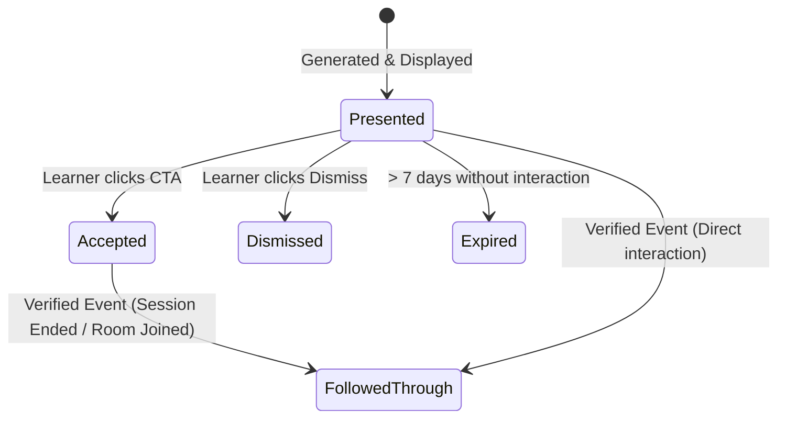

# StudySync AI

An intelligent peer-learning platform designed to help students discover compatible study partners, create and join topic-based learning rooms, collaborate, exchange notes, study together, and receive personalized learning recommendations.

---

## Current Development Phase

**Phase 16: Complete Feature QA, Pre-Submission Release Gate & Verification (Verified)**

A comprehensive quality-assurance audit and verification of StudySync AI was conducted across the frontend, backend, native SQLite database, authentication security, peer matching, collaboration, focus tools, and evaluation telemetry.

Key milestones and verifications:
- **100% Automated Test Pass Rate**: **671 automated tests** across **107 test suites** passed with 0 failures, 0 regressions, and strict transactional data isolation (`npm run test:server`).
- **Clean Production Build**: 100% clean production bundle build (`npm run build` completed in ~3.75s with 0 errors).
- **Web Cookie-First Authentication**: Issued HttpOnly session cookies with Lax SameSite, CSRF protection via custom headers, and backward-compatible bearer tokens for mobile clients.
- **Evidence-Based ML Audit**: Data-readiness audit halted supervised learning on real data due to zero label variance (8 records, 100% `presented`); synthetic benchmark proved heuristic baseline outperforms candidate ML model (F1: 60.5% vs 48.5%).
- **Complete Technical Documentation**: Full system documentation available in [`docs/`](./docs/):
  - [`docs/PROJECT_OVERVIEW.md`](./docs/PROJECT_OVERVIEW.md) — Problem statement, target users, and key features.
  - [`docs/ARCHITECTURE.md`](./docs/ARCHITECTURE.md) — Frontend, backend, database, and deployment architecture.
  - [`docs/AI_METHODS_AND_EVALUATION.md`](./docs/AI_METHODS_AND_EVALUATION.md) — Real matching algorithms, scoring rules, and evaluation results.
  - [`docs/DEMO_SCRIPT.md`](./docs/DEMO_SCRIPT.md) — 5-minute two-account evaluation walkthrough.
  - [`docs/KNOWN_LIMITATIONS.md`](./docs/KNOWN_LIMITATIONS.md) — Deployment constraints, free-tier limits, and planned features.
  - [`docs/PORTFOLIO_SUMMARY.md`](./docs/PORTFOLIO_SUMMARY.md) — Professional engineering summary.
- **Zero Paid Dependencies**: Pure native Node.js test runner, native `node:sqlite` database, and vanilla CSS design tokens.

---

## Technology Stack

The project is built entirely on open, lightweight, zero-cost technologies compatible with free-tier hosting (e.g., Vercel, Netlify, Cloudflare Pages, GitHub Pages):

- **Core & Runtime**: HTML5, Vanilla JavaScript (ES Modules), Node.js
- **Frontend Framework**: [React 19](https://react.dev/)
- **Build Tool & Bundler**: [Vite 6](https://vite.dev/)
- **Routing**: [React Router DOM v7](https://reactrouter.com/) (Client-side SPA Routing)
- **Styling**: Vanilla CSS Design Tokens (Custom Properties, modular typography, spacing, surface, and elevation scales)
- **Local State Management**: React Context (`AppContext.jsx`) with centralized state for rooms, membership sets, discussions, doubt queues, notes, sessions, active timers, invites, and notifications.
- **Zero Paid Dependencies**: Genuine free-tier and open-source infrastructure only.

---

## Topic Room Architecture (Phase 3)

### 1. Extended Room Model
Every room in `src/data/rooms.js` and `AppContext.jsx` supports:
- `id` / `roomId`: Unique identifier
- `title` / `name`: Descriptive room title
- `subject` & `topic`: Academic syllabus context
- `description` & `learningGoal`: Specific conceptual goals
- `roomType`: `Learn Together`, `Revision`, `Doubt Solving`, `Peer Teaching`, or `Exam Revision`
- `difficulty`: `Beginner`, `Intermediate`, or `Advanced`
- `languages`: Array of supported languages (e.g., English, Tamil, Hindi)
- `creator`: Student username
- `memberCount` & `maxCapacity`: Room enrollment limits
- `activeNowCount`: Real-time online learner count
- `activityStatus` & `statusCategory`: Activity state (*Active now*, *Quiet · Last activity 3h ago*, *Inactive · Last activity 2d ago*)
- `tags`: Array of search keywords (e.g., `1NF`, `2NF`, `3NF`, `BCNF`, `Decomposition`)
- `whatDiscussing`: Array of active review bullet points
- `learningActivityMetrics`: Mock participation metrics (learners joined today, notes shared, questions discussed, sessions completed)
- `members`: Roster of participants with `{ id, name, initials, currentTopic, learningLevel, status, task }`
- `resources`: Pinned materials with `{ id, title, type, topic, description }` (types: *Note, PDF, Link, Cheat Sheet, Question Set*)
- `mockMessages`: Discussion feed with `{ id, sender, initials, time, text, topicTag }`
- `questions`: Structured doubts with `{ id, question, topic, asker, askerInitials, time, resolved, responses: [{ id, author, text, time }] }`
- `activityTimeline`: Event log of recent room milestones

### 2. Room Interactions
- **Join / Leave Room**: Instant local state toggle updating user status in roster, total participant count, card badge (`Joined`), and timeline.
- **Topic Discussion**: Fast local chat with sender badge, time, text, and optional concept tag (`3NF`, `Proof`, `Complexity`).
- **Ask a Doubt & Peer Responses**: Dedicated doubt submission with subtopic; peer responses thread; interactive **Mark as Resolved** toggle.
- **Knowledge Sharing**: In-room modal for adding mock resources (*Cheat Sheet, Note, PDF, Question Set, Link*).
- **Integrated Room Notes**: Displays notes matching room subject/topic; direct triggers to *"Open Note"* or *"Create Note"*.
- **Find Study Partner from Room**: Context-aware modal showing peers who excel in this room's exact topic with compatibility percentages, reasons, and invitation controls.
- **Adaptive Room Type UI Emphasis**:
  - *Learn Together*: Emphasizes active co-studying and discussion.
  - *Revision*: Emphasizes revision topics and summaries.
  - *Doubt Solving*: Emphasizes questions, answers, and resolved doubts.
  - *Peer Teaching*: Emphasizes explanations and tutoring exchanges.
  - *Exam Revision*: Emphasizes practice problem sets and study sessions.
- **Create Room Improvements**:
  - *Topic Suggestions*: Displays subject-tailored pills (*Normalisation, Transactions, Indexing, ER Model, SQL*). Clicking populates the topic.
  - *Duplicate Warning*: Detects existing similar rooms in local catalog, offering *"Join Existing Room"* or *"Create Anyway"*.

---

## Backend & Database Architecture (Phase 4)

StudySync AI uses a decoupled, zero-cost backend architecture built with **Node.js (ES Modules)**, **Express 5**, and **SQLite** (using Node 24 native `DatabaseSync`).

### 1. Directory Structure

```
server/
├── app.js                 # Express application assembly, CORS & security middleware
├── index.js               # Entry point (auto-migration check, auto-seeding, server listener)
├── config/
│   └── env.js             # Environment configuration with safe defaults
├── db/
│   ├── connection.js      # Database connection, PRAGMA foreign_keys, WAL mode
│   ├── migrate.js         # Idempotent migration runner (tracks _migrations)
│   ├── seed.js            # Safe development seed (fictional users, topics, rooms)
│   ├── data/              # SQLite database storage directory (git-ignored)
│   └── migrations/
│       └── 001_initial_schema.sql  # Relational DDL schema & indexes
├── middleware/
│   ├── errorHandler.js    # Sanitized error handler (no leaked credentials/traces)
│   └── notFoundHandler.js # Consistent JSON 404 handler
├── models/
│   ├── user.model.js      # Users and learning preferences data access
│   ├── topic.model.js     # Syllabus topics and subjects data access
│   ├── room.model.js      # Room details, rosters, chat messages, and doubt queries
│   ├── note.model.js      # Notes and shared academic resources data access
│   └── session.model.js   # Study sessions and individual participant durations
├── routes/
│   ├── health.routes.js   # Liveness & database connectivity verification
│   ├── topic.routes.js    # Syllabus topics and subjects retrieval endpoints
│   └── room.routes.js     # Development rooms retrieval endpoints
├── schemas/
│   └── index.js           # Request validation schemas and standardized JSON formatters
├── services/
│   ├── topic.service.js   # Curriculum business logic
│   └── room.service.js    # Room data retrieval business logic
└── tests/
    ├── testHelper.js      # Ephemeral test server helper
    ├── health.test.js     # Health probe & database readiness tests
    ├── topics.test.js     # Topic listing, subject catalog, filtering tests
    ├── rooms.test.js      # Room listings, participant rosters, message feed tests
    └── schema.test.js     # Schema constraints, FK cascade, uniqueness & validation tests
```

### 2. Database Selection & Relational Design

- **Engine**: SQLite via Node.js native `DatabaseSync` (`node:sqlite`).
- **Cost & Complexity**: **$0 / Free**. Zero cloud account requirements, zero mandatory subscriptions, zero native compilation toolchain hurdles on Windows (`node-gyp`).
- **Relational Integrity**:
  - Enforces `PRAGMA foreign_keys = ON;` on all connections.
  - High performance via `PRAGMA journal_mode = WAL;`.
  - Cascades deletions where appropriate (e.g. deleting a room deletes its messages and memberships).
  - Protects authors and room creators (`ON DELETE RESTRICT`) against accidental data loss.
  - Distinguishes overall study session duration (`planned_duration`) from each participant's individual focus time (`individual_duration_minutes`).
  - Strict uniqueness constraints: `UNIQUE(room_id, user_id)` prevents duplicate room memberships; `UNIQUE(user_id, topic_id)` prevents duplicate user preferences.

#### Schema Entities (11 Tables & Phase 8 Enhancements)
1. `users` — Student profiles, display names, emails, avatars, preferred languages, and hashed passwords.
2. `learning_topics` — Coursework topics, subjects, difficulty levels, descriptions.
3. `user_learning_preferences` — Individual student learning goals, self-reported skill levels, study duration preferences.
4. `rooms` — Academic rooms, subject syllabus, topics, room types, capacities, statuses.
5. `room_memberships` — Unique student enrollment in rooms with roles and timestamps.
6. `room_messages` — Academic discussion messages with room and sender links.
7. `room_questions` — Structured doubts with subtopic and resolution state (`is_resolved`). Indexed by `room_id`, `asker_id`, and `is_resolved`.
8. `question_responses` — Peer explanations and replies to doubts. Indexed by `question_id` and `responder_id`.
9. `notes_resources` — Persistent notes and shared reference resources with `author_id`, `visibility` (`private`, `room_shared`, `session_shared`, `public`), optional `room_id` and `session_id`, `is_archived`, and sanitized `resource_reference` URL. Indexed by `author_id`, `room_id`, `session_id`, `visibility`, and `is_archived`.
10. `study_sessions` — Focus blocks, agendas, planned duration, actual start/end timestamps.
11. `session_participants` & `session_attendance_intervals` — Individual student participation records with tracked duration and discrete intervals.
12. `learning_activities` — Audit logs of user study milestones.

### 3. Implemented API Endpoints

| Method | Endpoint | Description | Auth Required | Response Status |
|---|---|---|---|---|
| `GET` | `/api` | Root API metadata and directory | No | `200 OK` |
| `GET` | `/api/health` | Liveness health probe and uptime | No | `200 OK` |
| `GET` | `/api/health/db` | Database connectivity, table count & migration status | No | `200 OK` |
| `POST` | `/api/auth/register` | Register new user account with scrypt password hash | No | `201 Created` / `400` / `409 Conflict` |
| `POST` | `/api/auth/login` | Sign in with email and password, issue session token | No | `200 OK` / `401 Unauthorized` |
| `POST` | `/api/auth/logout` | Revoke active session token | **Yes** | `200 OK` / `401 Unauthorized` |
| `GET` | `/api/auth/me` | Get current authenticated user & profile status | **Yes** | `200 OK` / `401 Unauthorized` |
| `GET` | `/api/profile/me` | Retrieve own complete learner profile & preferences | **Yes** | `200 OK` / `401 Unauthorized` |
| `PUT` | `/api/profile/me` | Update own profile info, headline, bio & schedule | **Yes** | `200 OK` / `400` / `401 Unauthorized` |
| `PUT` | `/api/profile/preferences` | Update topic preferences (learning now, strengths, goals) | **Yes** | `200 OK` / `400` / `401 Unauthorized` |
| `DELETE` | `/api/profile/preferences/:topicId` | Remove specific topic preference | **Yes** | `200 OK` / `401 Unauthorized` |
| `GET` | `/api/topics` | List syllabus topics (filters: `?subject=`, `?difficulty=`) | No | `200 OK` / `400 Bad Request` |
| `GET` | `/api/topics/subjects` | List distinct syllabus subjects | No | `200 OK` |
| `GET` | `/api/topics/:id` | Get single topic by ID | No | `200 OK` / `404 Not Found` |
| `GET` | `/api/rooms` | List persistent rooms (search, subject, topic, difficulty, type, language, status, pagination) | Optional | `200 OK` / `400 Bad Request` |
| `GET` | `/api/rooms/recommendations` | Deterministic room recommendations based on learner syllabus topics | Optional | `200 OK` |
| `POST` | `/api/rooms` | Create new study room with verified creator identity & auto-enrollment | **Yes** | `201 Created` / `400` / `401 Unauthorized` |
| `GET` | `/api/rooms/:id` | Get room details, roster, messages, questions, and membership state | Optional | `200 OK` / `404 Not Found` |
| `PUT` | `/api/rooms/:id` | Update room metadata and capacity (creator only) | **Yes** | `200 OK` / `400` / `403 Forbidden` / `404` |
| `DELETE` | `/api/rooms/:id` | Archive room safely without destroying learning history (creator only) | **Yes** | `200 OK` / `403 Forbidden` / `404` |
| `POST` | `/api/rooms/:id/join` | Join room with duplicate prevention and capacity enforcement | **Yes** | `200 OK` / `401` / `409 Conflict` |
| `POST` | `/api/rooms/:id/leave` | Leave room with ownership safeguards (creator cannot abandon active room) | **Yes** | `200 OK` / `400 Bad Request` / `401` |
| `GET` | `/api/rooms/:id/sessions` | List sessions associated with a specific topic room | Optional | `200 OK` / `404 Not Found` |
| `GET` | `/api/sessions` | List study sessions (filters: `?status=`, `?room_id=`, `?topic=`, `?limit=`) | Optional | `200 OK` / `400 Bad Request` |
| `GET` | `/api/sessions/history` | List session history for the authenticated user | **Yes** | `200 OK` / `401 Unauthorized` |
| `POST` | `/api/sessions` | Create persistent study session with server creator ID & auto-enrollment | **Yes** | `201 Created` / `400` / `401 Unauthorized` |
| `GET` | `/api/sessions/:id` | Get session details, active participants, and discrete intervals | Optional | `200 OK` / `404 Not Found` |
| `GET` | `/api/sessions/:id/summary` | Retrieve completed session summary with individual participant attendance | Optional | `200 OK` / `404 Not Found` |
| `POST` | `/api/sessions/:id/start` | Start session and record server `actual_start_at` (creator only) | **Yes** | `200 OK` / `400` / `403 Forbidden` |
| `POST` | `/api/sessions/:id/join` | Join session and open server attendance interval (prevents duplicates) | **Yes** | `200 OK` / `400` / `401` / `409 Conflict` |
| `POST` | `/api/sessions/:id/leave` | Leave session, close active attendance interval, tally elapsed seconds | **Yes** | `200 OK` / `400` / `401 Unauthorized` |
| `POST` | `/api/sessions/:id/end` | End session, close all active intervals, finalize records (creator only) | **Yes** | `200 OK` / `400` / `403 Forbidden` |
| `POST` | `/api/sessions/:id/feedback` | Submit post-session feedback and learning rating | **Yes** | `201 Created` / `400` / `401 Unauthorized` |
| `POST` | `/api/sessions/:id/focus` | Record self-reported focused study minutes for authenticated participant | **Yes** | `200 OK` / `400` / `401 Unauthorized` |
| `GET` | `/api/notes` | List persistent notes visible to user (search, topic, subject, visibility filters) | Optional | `200 OK` / `400 Bad Request` |
| `POST` | `/api/notes` | Create persistent note with server author identity & visibility rules | **Yes** | `201 Created` / `400` / `401 Unauthorized` |
| `GET` | `/api/notes/:id` | Get note by ID with visibility authorization check (403 for private notes of others) | Optional | `200 OK` / `403 Forbidden` / `404` |
| `PUT` | `/api/notes/:id` | Update note title, content, tags, visibility, room/session links (author only) | **Yes** | `200 OK` / `400` / `403 Forbidden` / `404` |
| `DELETE` | `/api/notes/:id` | Soft-delete / archive note (author only) | **Yes** | `200 OK` / `403 Forbidden` / `404` |
| `GET` | `/api/rooms/:id/questions` | List doubts and questions with replies for a topic room | Optional | `200 OK` / `404 Not Found` |
| `POST` | `/api/rooms/:id/questions` | Post a doubt/question in a topic room (room members or creator only) | **Yes** | `201 Created` / `400` / `403 Forbidden` |
| `POST` | `/api/rooms/:id/questions/:questionId/replies` | Submit peer explanation/reply to a question (room members or creator only) | **Yes** | `201 Created` / `400` / `403 Forbidden` |
| `PATCH` | `/api/rooms/:id/questions/:questionId/resolve` | Toggle question resolution status (question author or room creator only) | **Yes** | `200 OK` / `403 Forbidden` / `404` |
| `DELETE` | `/api/rooms/:id/questions/:questionId` | Delete doubt/question and replies (question author or room creator only) | **Yes** | `200 OK` / `403 Forbidden` / `404` |
| `GET` | `/api/rooms/:id/resources` | List shared learning resources for a topic room | Optional | `200 OK` / `404 Not Found` |
| `POST` | `/api/rooms/:id/resources` | Share external resource with safe URL validation (room members or creator only) | **Yes** | `201 Created` / `400` / `403 Forbidden` |
| `DELETE` | `/api/rooms/:id/resources/:resourceId` | Remove shared resource (resource uploader or room creator only) | **Yes** | `200 OK` / `403 Forbidden` / `404` |

### 4. Authentication & Profile Architecture (Phase 5)

- **Password Security**: Uses Node.js native `crypto.scrypt` with a cryptographically random 16-byte salt per user and timing-safe equality comparison (`timingSafeEqual`) to prevent side-channel and timing attacks.
- **Session Management**: Session tokens are cryptographically generated (32-byte hex) and validated directly in the `user_sessions` SQLite table with an expiration timestamp. Signing out immediately revokes and deletes the server-side session record.
- **Authorization Enforcement**: Every private profile endpoint strictly enforces `req.user.id` obtained from the validated session. Client-supplied IDs in query or body parameters cannot override the authenticated user identity, fully preventing cross-user profile tampering.
- **5-Step Onboarding**:
  1. *Academic Identity*: Headline/degree, institution, short intro, skill level.
  2. *Preferred Languages*: Academic discussion languages (English, Tamil, Hindi, etc.).
  3. *Subjects & Syllabus Topics*: Selection of coursework modules and syllabus topics.
  4. *Learning Goals*: Custom milestone goals.
  5. *Study Schedule*: Preferred Pomodoro sprint duration (e.g. 25, 45, 60 min) and study availability.
- **Interactive Profile Editing**: The Profile page allows immediate inline/modal editing of bio, headline, schedule, duration, strengths, improvement areas, and learning goals, persisting updates to SQLite in real-time.

### 5. Study Sessions & Individual Participation Architecture (Phase 7)

- **Session Lifecycle**:
  - `Scheduled`: Session created for upcoming collaboration with planned duration.
  - `Active`: Session initiated by creator; `actual_start_at` recorded on server.
  - `Completed`: Session ended by creator; `actual_end_at` recorded, active participant intervals closed, and summary calculated.
  - `Cancelled`: Session cancelled prior to completion.
- **Discrete Attendance Intervals vs. Self-Reported Focus**:
  - Each participant's session attendance is recorded in `session_attendance_intervals` with exact server-side `joined_at` and `left_at` ISO timestamps.
  - When participants leave and rejoin, prior intervals are preserved and summed into `total_attendance_seconds`.
  - Group attendance is never averaged or shared: each learner has their own distinct recorded attendance duration.
  - Attendance time is distinctly segregated from self-reported focus time (`recorded_study_minutes`).
- **Server-Authoritative Timers**:
  - Timers compute elapsed duration from `actual_start_at`.
  - Timers survive full browser reloads and navigation between pages without resetting.
  - Frontend runs a lightweight local tick interval strictly for visual smoothness without modifying server timestamps.
- **Authorization & Security**:
  - Starting and ending sessions is strictly restricted to the session creator.
  - A creator leaving a session closes their own attendance interval without prematurely destroying or terminating the session for remaining peers.
  - Duplicate active participation is prevented at the database and application level.
  - Completed sessions reject further join requests.
  - Participants cannot edit or tamper with peers' recorded study times.

### 6. Notes, Resources & Knowledge Exchange Architecture (Phase 8)

- **Note Visibility Matrix & Isolation**:
  - `private`: Accessible strictly and exclusively to the authenticated author (`author_id = req.user.id`). Other authenticated learners or unauthenticated visitors cannot view or query these notes; direct ID access responds with `403 FORBIDDEN`.
  - `room_shared`: Accessible to enrolled members of the associated `room_id` or the room creator.
  - `session_shared`: Accessible to participants of the associated `session_id`.
  - `public`: Accessible to any authenticated or guest learner across the platform.
- **Server-Derived Ownership & Immutable Security**:
  - Note creation (`POST /api/notes`) derives `author_id` strictly from `req.user.id`. Any author ID passed in the payload is discarded.
  - Note modifications (`PUT /api/notes/:id`) and deletion/archive (`DELETE /api/notes/:id`) enforce `note.author_id === req.user.id`.
- **Topic Room Resources**:
  - Pinned learning resources store metadata: `id`, `title`, `description`, `topic`, `type` (*Note, PDF, Link, Cheat Sheet, Question Set*), `room_id`, `author_id`, and `url` (`resource_reference`).
  - Safe URL Validation: Submitted URLs must strictly match `http:` or `https:` protocols. Arbitrary schemes (`javascript:`, `data:`, `file:`) and dangerous payloads are rejected.
  - Creation is restricted to active room members and the room creator.
  - Resource deletion is permitted only to the resource uploader or the room creator.
- **Peer-to-Peer Knowledge Exchange**:
  - Doubts and questions (`room_questions`) can be asked by authorized room members.
  - Peer replies (`question_responses`) can be posted by room members and room creator.
  - Resolution Toggle (`PATCH /api/rooms/:id/questions/:questionId/resolve`): Question authors and room creators can toggle resolution status (`is_resolved = 1` or `0`).
  - Question Deletion (`DELETE /api/rooms/:id/questions/:questionId`): Cascades to replies, permitted strictly for question authors and room creators.
  - Doubts, responses, and resolution status persist across page refreshes.
- **Testing Knowledge Exchange Locally**:
  - Notes: Navigate to `/notes` to view persistent notes; click "+ Create Note" to author a note with title, subject, topic, tags, and visibility.
  - Room Resources: In any Topic Room, open the "Resources" tab and click "+ Add Resource" to share a learning link.
  - In-Room Doubts: In any Topic Room, open the "Doubts & Discussion" tab to ask a question, reply to peers, or toggle resolution.

---

## Environment Configuration

Copy `.env.example` to `.env` or `.env.local` to customize runtime settings:

```env
# Frontend Client (Vite)
VITE_APP_NAME=StudySync AI
VITE_APP_ENV=development
VITE_APP_VERSION=0.1.0
VITE_API_BASE_URL=http://localhost:3001/api

# Backend Server
PORT=3001
NODE_ENV=development
CORS_ORIGIN=http://localhost:5173
DATABASE_PATH=./server/data/studysync.db
```

---

## Getting Started

### Prerequisites

- [Node.js](https://nodejs.org/) (v22.5.0 or higher recommended, tested on v24)
- `npm` (v9.0.0 or higher)

### Installation

Clone the repository and install dependencies:

```bash
npm install
```

### Database Setup

The backend automatically creates tables, applies migrations, and seeds sample data on first run. To manually execute migrations or seeds:

```bash
# Apply schema migrations (Migrations 001, 002, 003, 004 & 005)
npm run db:migrate

# Populate development seed data (idempotent with hashed passwords)
npm run db:seed
```

### Running Locally

Run frontend and backend in separate terminals:

#### 1. Start the Backend API Server
```bash
npm run server
# Or with auto-reload:
npm run server:dev
```
The API will be available at: `http://localhost:3001/api`

#### 2. Start the Frontend Development Server
```bash
npm run dev
```
The client will be accessible at: `http://localhost:5173/`

### Running Backend Tests

Run the comprehensive automated test suite (176 tests across 15 test suites covering auth, profiles, rooms, study sessions, attendance intervals, notes, resources, doubt exchange, weighted peer matching, Learning DNA, Knowledge Map, focus mode, feedback loops, fair recommendations, safety, privacy, moderation, and Phase 15 multi-user end-to-end integration flows):

```bash
npm run test:server
```

### Building the Frontend for Production

```bash
npm run build
```

---

## Phase 9 Architecture: AI Layer & Intelligent Recommendations

### 1. Differentiator & Objective
StudySync AI's core differentiator is:
> **Connect the right learner with the right peer for the right topic at the right time.**

Phase 9 implements this using real authenticated profiles, syllabus preferences, verified attendance records, and room discussions from SQLite.

### 2. Transparent Weighted Matching Algorithm

The matching engine calculates an explainable composite compatibility score ($0\text{--}100\%$) for every candidate peer in the database:

$$\text{Compatibility Score} = \sum_{i} W_i \times S_i$$

| Dimension | Initial Weight ($W_i$) | Engineering Purpose & Scoring Logic |
|---|---|---|
| **Topic Similarity** | **25% (0.25)** | Measures syllabus overlap. Uses normalized text matching, canonical taxonomy nodes, and alias sets. Exact match = 100%, canonical alias match = 92%, same category = 75%, distinct sub-topic in same subject = 28%, different subjects = 0%. |
| **Skill Compatibility** | **15% (0.15)** | Supports reciprocal peer teaching, targeted help-seeking (when a learner seeks help in an improving topic from someone holding verified strength), or balanced collaborative study. A learner is never permanently labeled only a teacher or only a learner. |
| **Goal Compatibility** | **15% (0.15)** | Evaluates alignment of self-reported academic goals (e.g. Exam Revision, Problem Sets, Concept Deep-Dive). Aligned goals = 100%, related goals = 80-95%. |
| **Schedule Alignment** | **10% (0.10)** | Compares availability windows (weekday evenings, weekday mornings, weekends, late night). Matching windows = 100%, partial overlaps = 85-90%, open/flexible = 80%, disjoint = 25%. |
| **Language Compatibility** | **10% (0.10)** | Jaccard intersection of preferred spoken/study languages. Multiple shared languages = 100%, single shared language = 95%, disjoint = 10%. |
| **Learning Style (Duration)** | **10% (0.10)** | Evaluates preferred focus block duration: $1 - \frac{|\text{dur}_A - \text{dur}_B|}{\max(\text{dur}_A, \text{dur}_B, 90)}$. 45m vs 45m = 100%, 45m vs 60m = 83%. |
| **Verified Reliability** | **10% (0.10)** | Derived authoritatively from `session_participants` and post-session feedback. Ratio of completed sessions and positive reflections. New learners receive an impartial 80% baseline. |
| **Prior Collaboration** | **5% (0.05)** | Prior successful co-studying in study sessions (100%) or active co-memberships in topic rooms (85%). Unacquainted learners receive a neutral 60% without penalty. |

*Weights are initial engineering choices, configurable via `MatchingEngine.getWeights()`, and evaluated against accepted recommendations and session completions.*

### 3. Matching Scenarios Supported

1. **Same-Topic Collaborative Learning**: Both learners studying the same syllabus topic with balanced skill levels.
2. **Help-Seeking / Mentorship**: Learner marked a topic as needing improvement (`is_improving = 1`); peer marked it as a strength (`is_strength = 1`).
3. **Reciprocal Peer Teaching**: Learner A holds strength in Topic X (needed by Peer B), while Peer B holds strength in Topic Y (needed by Learner A).
4. **Exam Revision Alignment**: Both learners preparing for examinations with compatible timelines.
5. **Schedule & Goal Compatibility**: Synchronized study hours and aligned focus sprint durations.

### 4. Personalised Learning Recommendation Engine

Recommendations analyze real database state and produce explainable study guidance:
- **Continue Topic** (`continue_topic`): Prompts continuation on active syllabus focus blocks.
- **Peer Help** (`peer_help`): Identifies peers with verified strength in topics marked difficult, or in rooms with unresolved doubts.
- **Spaced Revision** (`revisit_topic`): Prompts review for syllabus topics not studied recently.
- **Join Active Room** (`join_room`): Discovers active topic rooms for the learner's subjects.
- **Review Resource** (`review_resource`): Highlights shared notes or cheatsheets covering target topics.
- **Transparent Onboarding** (`onboarding_explore`): Guides new learners to select interests without inventing false histories.

*Every recommendation provides an explicit explanation of why it was suggested and never makes unsubstantiated claims of topic mastery based merely on time spent.*

### 5. Provider-Independent AI Architecture

- **Interface Contract** (`server/services/ai/aiProviderInterface.js`): Defines standard methods for peer insights and study tips.
- **Deterministic Rule-Based Provider** (`server/services/ai/ruleBasedProvider.js`): Always operational, zero external cost, deterministic explanations, explicitly labeled `isEnhanced: false`, `engine: 'deterministic_rule_based'`.
- **Optional Gemini Provider** (`server/services/ai/geminiProvider.js`): Activates only when `GEMINI_API_KEY` is configured on the server. Implements:
  - 4000ms safe abort timeout
  - In-memory rate limiting (max 15 requests per minute)
  - Non-blocking error handling: if Gemini is rate-limited, times out, or fails, gracefully falls back to rule-based insights.
  - Transparent labeling: only responses generated by the model are marked `ai_enhanced: true`.

### 6. Phase 9 API Endpoints

| Method | Endpoint | Auth | Description |
|---|---|---|---|
| `GET` | `/api/matches/status` | Optional | Returns matching engine weights, operational status, and active AI provider state. |
| `GET` | `/api/matches/peers` | Optional | Ranked peer recommendations based on query criteria (subject, topic, skill, goal, schedule, duration). Excludes requesting user and blocked candidates. |
| `POST` | `/api/matches/find` | Optional | Body-based candidate matching. |
| `POST` | `/api/matches/block` | Required | Blocks a candidate from future match results. |
| `GET` | `/api/recommendations/status` | Optional | Returns recommendation engine status and AI configuration. |
| `GET` | `/api/recommendations/study` | Optional | Returns personalised study recommendations for the authenticated learner. |
| `POST` | `/api/recommendations/feedback` | Required | Records recommendation interactions (accepted, dismissed, viewed). |

### 7. Database Migration 006

- **`user_blocks`**: Tracks user blocking relationships (`blocker_id`, `blocked_id`, `created_at`) with unique constraints and foreign keys.
- **`recommendation_interactions`**: Records learner interactions (`recommendation_type`, `target_id`, `action`, `feedback_text`, `created_at`) for evaluating algorithm effectiveness.

---

## Learning DNA & Knowledge Map Architecture (Phase 10)

Phase 10 introduces an explainable, authenticated Learning DNA profile, an interactive Knowledge Map, and strictly unbundled transparent progress tracking.

### 1. Learning DNA Fields & Purpose

Each learner has an editable, persistent learning profile that informs reciprocal study matching:

| Field | Type | Purpose | How It Improves Matching |
|---|---|---|---|
| **`subjects`** | String Array | Academic disciplines studied (e.g. Computer Science, Database Systems). | Filters candidate pools and room catalogs. |
| **`confidentTopics`** | Object Array | Topics the learner self-reports feeling confident about. | Paired with peers who marked those topics as difficult. |
| **`difficultTopics`** | Object Array | Topics where the learner desires more practice. | Prioritizes peer tutors, study rooms, and revision recommendations. |
| **`willingToTeachTopics`** | Object Array | Topics the learner explicitly opts into teaching or explaining. | Boosts reciprocal matching score when paired with learners requesting help. |
| **`wantsPeerSupportTopics`** | Object Array | Topics where the learner actively seeks peer assistance. | Matches with students willing to teach. |
| **`collaborationStyle`** | Enum String | Preferred interaction format: *Peer discussion & problem solving*, *Concept exchange & peer teaching*, *Quiet co-working with periodic Q&A*, *Structured exam revision & flashcards*, *Coding pairs & implementation review*. | Evaluates collaboration synergy during study sessions. |
| **`preferredStudyTimes`** | String | Timezone/availability windows (e.g., *Weekday evenings*). | Aligns schedule compatibility in matching. |
| **`preferredStudyDuration`**| Integer (min) | Target focus sprint block (e.g., 25, 45, 60, 90 mins). | Synchronizes Pomodoro intervals. |
| **`preferredLanguages`** | String Array | Spoken/written languages for study discussion. | Prevents language friction. |
| **`learningGoals`** | String Array | Milestones (e.g., *Master BCNF*, *Pass Midterm*). | Aligns goal synergy between study partners. |

*All fields are strictly optional, user-editable, and explain why the information is collected without inferring sensitive attributes.*

### 2. Knowledge Map Topic States

The Knowledge Map represents curriculum topics as interactive nodes. Topic states are deterministically assigned based on supporting database records:

| State | Badge / Color | Definition & Supporting Data Criteria |
|---|---|---|
| **`not_started`** | Neutral / Gray | Default state. The learner has logged zero study session attendance and recorded zero assessments for this topic. |
| **`in_progress`** | Primary / Blue | The learner has actively joined study sessions covering this topic (`session_participants`) or marked it as an active learning target in preferences, but has not completed a formal assessment. |
| **`needs_review`** | Warning / Amber | The learner has either: (a) marked the topic as difficult (`is_improving = 1` or `confidence_level = 'needs_improvement'`), (b) not attended a study session on this topic in >14 days (spaced repetition signal), or (c) scored <70% on a verified practice assessment. |
| **`assessed`** | Accent / Green | A real assessment record exists in `topic_assessments` with a passing score ($\ge 70\%$). If unassessed, the topic is never labeled as assessed. |

### 3. Transparent Progress Calculation & Honest Metrics

StudySync AI strictly separates different progress signals rather than compressing them into a misleading single "mastery percentage":

1. **Logged Study Session Attendance**: Measures hours and sessions attended with peers. *Explicitly notes: Attendance measures participation, not verified comprehension.*
2. **Self-Reported Confidence**: Reflected by user preferences (confident, neutral, needs improvement). Labeled as self-reported feelings, not exam results.
3. **Verified Assessment Records**: Real quizzes recorded in `topic_assessments` with percentage score, assessment type, and timestamp. Unassessed topics are clearly marked as unassessed.
4. **Knowledge Exchange**: Count of notes created, doubts asked, and peer questions resolved in collaborative Topic Rooms.

### 4. Topic Relationships & Prerequisite Pathways

Curriculum topics are connected via explicit prerequisite edges (`topic_prerequisites` table):
- e.g., `SQL Fundamentals` $\longrightarrow$ `SQL Joins` $\longrightarrow$ `Subqueries`
- e.g., `Programming Fundamentals` $\longrightarrow$ `Data Structures` $\longrightarrow$ `Algorithms`

Learners can view:
- **Prerequisite Requirements**: Shows whether foundational topics have been assessed or studied first.
- **Recommended Next Action**:
  - `start_topic`: When all prerequisites are met.
  - `prerequisite_first`: When a foundational concept is still uncompleted.
  - `advance`: When the current topic is mastered and downstream topics are unlocked.
  - `find_peer`: When the topic needs review and peer support was requested.
  - `teach_peers`: When the topic was passed with high score and the user is willing to teach.

### 5. Phase 10 Database Migration (007)

```sql
-- Migration 007: Learning DNA & Knowledge Map
ALTER TABLE learner_profiles ADD COLUMN collaboration_style TEXT DEFAULT 'Peer discussion & problem solving';

ALTER TABLE user_learning_preferences ADD COLUMN confidence_level TEXT DEFAULT 'neutral';
ALTER TABLE user_learning_preferences ADD COLUMN willing_to_teach INTEGER DEFAULT 0;
ALTER TABLE user_learning_preferences ADD COLUMN wants_peer_support INTEGER DEFAULT 0;

CREATE TABLE IF NOT EXISTS topic_assessments (
  id TEXT PRIMARY KEY,
  user_id TEXT NOT NULL REFERENCES users(id) ON DELETE CASCADE,
  topic_id TEXT NOT NULL REFERENCES topics(id) ON DELETE CASCADE,
  score_percentage REAL NOT NULL CHECK(score_percentage >= 0 AND score_percentage <= 100),
  passed INTEGER NOT NULL DEFAULT 1,
  assessment_type TEXT NOT NULL DEFAULT 'practice_quiz',
  assessed_at DATETIME DEFAULT CURRENT_TIMESTAMP
);

CREATE TABLE IF NOT EXISTS topic_prerequisites (
  id TEXT PRIMARY KEY,
  topic_id TEXT NOT NULL REFERENCES topics(id) ON DELETE CASCADE,
  prerequisite_topic_id TEXT NOT NULL REFERENCES topics(id) ON DELETE CASCADE,
  is_mandatory INTEGER NOT NULL DEFAULT 1,
  created_at DATETIME DEFAULT CURRENT_TIMESTAMP,
  UNIQUE(topic_id, prerequisite_topic_id)
);
```

### 6. Phase 10 API Endpoints

| Method | Endpoint | Auth | Description |
|---|---|---|---|
| `GET` | `/api/dna` | Required | Retrieves the authenticated learner's complete Learning DNA, field explanations, and topic preferences. |
| `PUT` | `/api/dna` | Required | Updates Learning DNA preferences (collaboration style, availability, topic confidences, willingness to teach, peer support requests). |
| `GET` | `/api/knowledge-map` | Required | Retrieves the learner's interactive topic map with calculated topic states, study activities, assessment records, and recommended actions. |
| `GET` | `/api/knowledge-map/progress` | Required | Retrieves unbundled transparent progress signals (self-reported, verified, attendance, knowledge exchange). |
| `GET` | `/api/knowledge-map/paths` | Required | Retrieves prerequisite graph edges and suggested curriculum pathways. |
| `POST` | `/api/knowledge-map/assessments` | Required | Records a verified topic assessment or practice quiz result. |

---

## Distraction Shield & Focus Mode Architecture (Phase 11)

### 1. Overview & Core Purpose
Phase 11 introduces a distraction-free Focus Mode and an in-app Distraction Shield designed to reduce avoidable interruptions during independent study sprints and collaborative study sessions without making fraudulent claims or requesting invasive operating system privileges.

Key guarantees:
1. **No Application Blocking or Device Surveillance**: StudySync AI does not install invasive background daemons, accessibility sniffers, or process surveillance hooks. It provides honest in-app muting and clear, respectful manual guidance for device-level Do Not Disturb (DND).
2. **Strict Timer Reliability via Wall-Clock References**: Timers derive elapsed and remaining time from persistent ISO timestamps (`started_at`, `paused_at`, `total_paused_seconds`). Timers seamlessly recover across page reloads, tab closures, and network drops via `GET /api/focus/active`.
3. **Distinct from Collaborative Session Duration**: Individual focus sprint intervals remain strictly separate from overall group session attendance.
4. **Honest Focus Statistics with Prominent Disclaimers**: Focus records track timer duration only. Disclaimers explicitly state that recorded timer duration measures elapsed time, not verified concentration, cognitive focus, or conceptual mastery.
5. **Selective In-App Notification Suppression**: Suppresses non-critical StudySync toast popups during active focus sprints while strictly preserving essential account, authentication, and security error alerts.

### 2. Database Schema (Migration 008)

```sql
CREATE TABLE IF NOT EXISTS user_focus_intervals (
  id TEXT PRIMARY KEY,
  user_id TEXT NOT NULL REFERENCES users(id) ON DELETE CASCADE,
  session_id TEXT REFERENCES study_sessions(id) ON DELETE SET NULL,
  room_id TEXT REFERENCES topic_rooms(id) ON DELETE SET NULL,
  topic TEXT NOT NULL,
  subject TEXT,
  planned_duration_seconds INTEGER NOT NULL,
  actual_duration_seconds INTEGER DEFAULT 0,
  total_paused_seconds INTEGER DEFAULT 0,
  status TEXT NOT NULL CHECK(status IN ('active', 'paused', 'completed', 'cancelled')) DEFAULT 'active',
  started_at DATETIME NOT NULL,
  paused_at DATETIME,
  completed_at DATETIME,
  created_at DATETIME DEFAULT CURRENT_TIMESTAMP,
  updated_at DATETIME DEFAULT CURRENT_TIMESTAMP
);

CREATE TABLE IF NOT EXISTS user_distraction_shield_settings (
  id TEXT PRIMARY KEY,
  user_id TEXT NOT NULL UNIQUE REFERENCES users(id) ON DELETE CASCADE,
  suppress_in_app_notifications INTEGER NOT NULL DEFAULT 1,
  hide_non_essential_nav INTEGER NOT NULL DEFAULT 0,
  break_reminders_enabled INTEGER NOT NULL DEFAULT 1,
  break_interval_minutes INTEGER NOT NULL DEFAULT 25,
  break_duration_minutes INTEGER NOT NULL DEFAULT 5,
  audio_chime_enabled INTEGER NOT NULL DEFAULT 0,
  created_at DATETIME DEFAULT CURRENT_TIMESTAMP,
  updated_at DATETIME DEFAULT CURRENT_TIMESTAMP
);
```

### 3. Phase 11 API Endpoints

| Method | Endpoint | Auth | Description |
|---|---|---|---|
| `GET` | `/api/focus/active` | Required | Retrieves the current user's active or paused focus interval, deriving elapsed and remaining seconds from wall-clock timestamps for recovery. |
| `POST` | `/api/focus/start` | Required | Starts a new focus interval. Returns `409 ACTIVE_FOCUS_INTERVAL_EXISTS` if a sprint is already active (unless `autoCancelPrevious: true`). |
| `POST` | `/api/focus/:id/pause` | Required | Pauses an active interval, recording `paused_at`. Forbidden to non-owners. |
| `POST` | `/api/focus/:id/resume` | Required | Resumes a paused interval, computing the paused duration and adding it to `total_paused_seconds`. |
| `POST` | `/api/focus/:id/complete` | Required | Concludes an interval, computing final actual duration. Safe to retry (idempotent). |
| `POST` | `/api/focus/:id/cancel` | Required | Cancels/discards an interval without creating ghost active timers. Safe to retry. |
| `GET` | `/api/focus/history` | Required | Retrieves paginated focus intervals, total recorded focus minutes, completed intervals count, and honest disclaimer. |
| `GET` | `/api/focus/settings` | Required | Retrieves distraction shield preferences, in-app notification suppression settings, and break reminder configuration. |
| `PUT` | `/api/focus/settings` | Required | Updates distraction shield preferences and break reminder intervals. |

---

## Learning Feedback Loop & Recommendation Improvement (Phase 12)

### 1. Overview & Core Philosophy
Phase 12 implements an evidence-based feedback loop that enables StudySync AI to continuously evaluate and refine peer matching and study recommendations using real learner interactions and observable application events.

Core principles:
1. **Evidence-Based Over Machine Learning Pretenses**: The system adjusts deterministic ranking algorithms using observable outcomes and smoothed ratings. It does not fabricate pseudo-AI model training.
2. **Strict Outcome Verification**: A recommendation is never marked as successful merely because it was displayed or clicked. Success requires verified follow-through events (e.g. session completed, room joined, assessment taken).
3. **Cold-Start Fairness**: New learners without recorded ratings receive neutral baseline standing ($80/100$) and are never disadvantaged or excluded from matching.
4. **Bayesian Smoothing Against Rating Volatility**: Requires minimum sample sizes ($N \ge 2$) before peer helpfulness influences candidate scores, preventing single outlier reviews from distorting rankings.
5. **Strict Privacy**: Private peer review notes and ratings are strictly confidential and never displayed publicly.

---

### 2. Recommendation Lifecycle & Outcome States

Each generated recommendation receives a persistent, deduplicated tracking record (`recommendation_tracking`):



- **`presented`**: Generated by the recommendation engine and shown to the recipient.
- **`accepted`**: The recipient explicitly initiated the recommended activity (e.g. clicked "Find Study Partner", "Browse Rooms").
- **`dismissed`**: The recipient clicked dismiss. Suppressed from re-recommendation for 7 days.
- **`expired`**: Recommendation was not acted upon within 7 days.
- **`followed_through`**: Verified by an authentic application event:
  - Peer recommendations $\longrightarrow$ Completed study session with recommended peer (`session_completed`).
  - Room recommendations $\longrightarrow$ Enrolled/joined Topic Room (`room_joined`).
  - Topic recommendations $\longrightarrow$ Completed topic assessment quiz (`assessment_taken`).

---

### 3. Explicit Feedback Signals & Post-Session Reviews

1. **Lightweight Recommendation Feedback** (`POST /api/feedback/recommendation`):
   - `isRelevant`: Binary relevance indicator ($1 = \text{Relevant}, 0 = \text{Not relevant}$).
   - `qualityRating`: Optional 1–5 integer rating.
   - `reasonTag`: Categorical tag (`too_difficult`, `already_know`, `good_match`, `not_interested`).
   - `feedbackText`: Brief optional comment.

2. **Peer Collaboration Reviews** (`POST /api/sessions/:id/peer-feedback` & `POST /api/feedback/peer`):
   - `wasHelpful`: Did the peer help with the topic? ($1 = \text{Yes}, 0 = \text{No}$).
   - `wouldStudyAgain`: Would you study with this peer again? ($1 = \text{Yes}, 0 = \text{No}$).
   - `topicRelevance`: Alignment of topic focus (1–5).
   - `feedbackNotes`: Confidential personal notes (strictly private, never exposed to other users).

*Participation Enforcement: Users can only review sessions they participated in (`session_participants`), and cannot submit reviews for themselves.*

---

### 4. Adaptive Matching Engine Improvements

Phase 12 enhances Phase 9 `MatchingEngine` without breaking the baseline scoring weights:

1. **Direct Pairwise Repeat Study Preferences**:
   - If User A gave Peer B `wouldStudyAgain = 1` $\longrightarrow$ Collaboration score boosted to $100\%$ with reason: *"Direct repeat preference: you gave positive feedback and requested to study together again"*.
   - If User A gave Peer B `wouldStudyAgain = 0` $\longrightarrow$ Collaboration score dampened to $25\%$ with reason: *"Prior collaboration preference: marked as not preferred for repeat study"*.

2. **Bayesian-Smoothed Peer Helpfulness**:
   - For candidates with $N \ge 2$ verified reviews:
     $$\text{Smoothed Ratio} = \frac{\text{Helpful Reviews} + M \times \mu}{\text{Total Reviews} + M}$$
     *(where prior sample weight $M = 2$ and prior mean $\mu = 0.85$)*
   - Adjustment bonus: $\Delta = \text{round}((\text{Smoothed Ratio} - 0.70) \times 20)$ (range: $-4$ to $+6$ points).
   - Prevents a single negative review from destroying an established learner's score.

3. **Stale & Dismissed Recommendation Suppression**:
   - Recommendations dismissed within the past 7 days are automatically excluded from `LearningRecommendationService.getRecommendationsForUser`.

---

### 5. Transparent Engineering Evaluation Metrics

Endpoint `GET /api/feedback/metrics` reports real database aggregates:

| Metric | Formula | Definition & Data Criteria |
|---|---|---|
| **Acceptance Rate** | $\frac{\text{Accepted Recs}}{\text{Presented Recs}}$ | Ratio of recommendations explicitly accepted vs total presented. |
| **Follow-Through Rate** | $\frac{\text{Followed-Through Recs}}{\text{Presented Recs}}$ | Ratio verified by actual events (`session_completed`, `room_joined`, `assessment_taken`). |
| **Peer Helpfulness Rate** | $\frac{\text{Helpful Votes}}{\text{Total Helpfulness Reviews}}$ | Percentage of completed session reviews where peer was rated helpful. |
| **Repeat Study Preference** | $\frac{\text{Repeat Study Votes}}{\text{Total Repeat Reviews}}$ | Percentage of completed session reviews where learner opted to study together again. |
| **Relevance Rate** | $\frac{\text{Relevant Votes}}{\text{Total Explicit Feedback}}$ | Percentage of explicit recommendation evaluations marked as relevant. |

*Small Sample Guard: Any metric with denominator $N < 5$ is explicitly flagged with `isSmallSample: true` and labeled "Small Sample (N=X)".*

---

### 6. Database Schema (Migration 009)

```sql
CREATE TABLE IF NOT EXISTS recommendation_tracking (
  id TEXT PRIMARY KEY,
  user_id TEXT NOT NULL REFERENCES users(id) ON DELETE CASCADE,
  recommendation_type TEXT NOT NULL,
  target_id TEXT NOT NULL,
  topic TEXT,
  subject TEXT,
  engine_version TEXT NOT NULL DEFAULT 'v2-adaptive',
  lifecycle_status TEXT NOT NULL CHECK(lifecycle_status IN ('presented', 'accepted', 'dismissed', 'expired', 'followed_through')) DEFAULT 'presented',
  outcome_event TEXT,
  outcome_entity_id TEXT,
  presented_at DATETIME DEFAULT CURRENT_TIMESTAMP,
  accepted_at DATETIME,
  dismissed_at DATETIME,
  followed_through_at DATETIME,
  created_at DATETIME DEFAULT CURRENT_TIMESTAMP,
  updated_at DATETIME DEFAULT CURRENT_TIMESTAMP
);

CREATE TABLE IF NOT EXISTS recommendation_explicit_feedback (
  id TEXT PRIMARY KEY,
  recommendation_tracking_id TEXT REFERENCES recommendation_tracking(id) ON DELETE SET NULL,
  user_id TEXT NOT NULL REFERENCES users(id) ON DELETE CASCADE,
  recommendation_type TEXT NOT NULL,
  target_id TEXT NOT NULL,
  is_relevant INTEGER CHECK(is_relevant IN (0, 1)),
  quality_rating INTEGER CHECK(quality_rating >= 1 AND quality_rating <= 5),
  reason_tag TEXT,
  feedback_text TEXT,
  created_at DATETIME DEFAULT CURRENT_TIMESTAMP,
  updated_at DATETIME DEFAULT CURRENT_TIMESTAMP,
  UNIQUE(user_id, recommendation_tracking_id)
);

CREATE TABLE IF NOT EXISTS peer_collaboration_feedback (
  id TEXT PRIMARY KEY,
  session_id TEXT REFERENCES study_sessions(id) ON DELETE SET NULL,
  giver_user_id TEXT NOT NULL REFERENCES users(id) ON DELETE CASCADE,
  target_peer_id TEXT NOT NULL REFERENCES users(id) ON DELETE CASCADE,
  was_helpful INTEGER CHECK(was_helpful IN (0, 1)),
  would_study_again INTEGER CHECK(would_study_again IN (0, 1)),
  topic_relevance INTEGER CHECK(topic_relevance >= 1 AND topic_relevance <= 5),
  feedback_notes TEXT,
  created_at DATETIME DEFAULT CURRENT_TIMESTAMP,
  updated_at DATETIME DEFAULT CURRENT_TIMESTAMP,
  UNIQUE(session_id, giver_user_id, target_peer_id)
);
```

---

### 7. Phase 12 API Endpoints

| Method | Endpoint | Auth | Description |
|---|---|---|---|
| `GET` | `/api/feedback/metrics` | Optional | Computes transparent engineering evaluation metrics with formulas, sample size warnings, and disclosures. |
| `GET` | `/api/feedback/my-feedback` | Required | Retrieves the authenticated learner's submitted recommendation and peer evaluations. |
| `POST` | `/api/feedback/recommendation` | Required | Submits or updates explicit relevance and quality feedback for a recommendation. |
| `POST` | `/api/feedback/peer` | Required | Submits peer helpfulness and repeat-study preference feedback. Self-review blocked. |
| `GET` | `/api/feedback/peer/:peerId` | Required | Retrieves pairwise feedback submitted by current user for target peer. |
| `POST` | `/api/sessions/:id/peer-feedback` | Required | Submits post-session peer review with verified participant authorization. |

---

## Phase 13: Advanced Peer Matching & Fair Recommendations

Phase 13 upgrades StudySync AI's matching engine into a two-sided, explainable, and fair recommendation system that pairs learners who can help each other make meaningful progress.

### 1. Three Core Learner Roles

StudySync AI explicitly supports three equally important peer relationship paradigms:

1. **Learner Seeking Help (`role: 'explainer'`)**: A learner who reports `needs_improvement`, doubts, or seeks concept guidance is matched with peers who have reported confidence, curriculum strengths, or willingness to teach that topic.
2. **Learner Who Can Explain (`role: 'learner_seeking_help'`)**: A learner who selects `help_others` or `practice_explaining` is paired with peers actively seeking explanations, maximizing pedagogical reinforcement for both parties.
3. **Reciprocal Peer Exchange (`role: 'reciprocal_exchange'`)**: A two-sided mutual exchange where User A explains a topic they have mastered (e.g., Programming Fundamentals) while learning another topic (e.g., SQL Joins) from User B who possesses complementary strengths.

---

### 2. Current Session Intent & Dynamic Preferences

Matching separates ephemeral session intent from permanent profile information:

- **Intent Types**:
  - `learn_together`: Balanced collaborative study and problem solving.
  - `find_explainer`: Targeted search for peers confident in the target topic.
  - `help_others`: Mentoring peers who need concept explanations.
  - `exam_revision`: Synchronized preparation for academic tests.
  - `solve_doubt`: Focused assistance on specific coursework hurdles.
  - `practice_explaining`: Active recall and concept articulation to reinforce mastery.
- **Dynamic Session Inputs**:
  - `topic`: Curriculum target topic (e.g., *Relational Algebra & SQL Joins*).
  - `subject`: Academic discipline (e.g., *Database Systems*).
  - `skillPreference`: `complementary` (seeks guidance/mentorship), `similar` (co-studying), or `any`.
  - `confidence`: Self-reported session confidence (`confident`, `needs_improvement`, `neutral`).
  - `desiredOutcome` / `learningGoal`: Specific session milestone.
  - `language`: Spoken/study language preference.
  - `preferredTime`: Available study window (e.g., *Weekday Evenings*, *Weekends*).
  - `duration`: Target session length in minutes (e.g., 45, 90).

---

### 3. Configurable Scoring Weights & Bayesian Reliability

The matching engine uses transparent, configurable weights that sum to 1.0 (100%):

| Factor | Default Weight | Description | Missing Data / Neutral Handling |
|---|---|---|---|
| **Topic Relevance** | **25%** (`topicSimilarity`) | Syllabus overlap and semantic distance using Phase 9 topic taxonomy. | Neutral baseline (50%) for general coursework enrollment. |
| **Skill Compatibility** | **15%** (`skillCompatibility`) | Two-sided complementary skill logic based on learner session intent. | Neutral baseline (70%) for compatible academic standing. |
| **Goal Alignment** | **15%** (`goalCompatibility`) | Alignment between desired session outcomes (e.g., Exam Revision, Doubt Solving). | Baseline 70% for shared course progression. |
| **Schedule Compatibility** | **10%** (`scheduleCompatibility`) | Overlapping study hours and availability windows. | Score 60% with explicit **"Schedule unconfirmed"** badge; 25% for confirmed mismatch. |
| **Language Compatibility** | **10%** (`languageCompatibility`) | Shared spoken/instruction languages. | 100% for shared languages, 50% baseline if unstated. |
| **Learning Style Alignment** | **10%** (`learningStyleCompatibility`) | Aligned session duration and collaboration style preferences. | Baseline 85% when duration or style is unstated. |
| **Reliability & Completion** | **10%** (`reliability`) | Stored session completion rate and Bayesian-smoothed peer helpfulness. | Cold-start baseline (80%). Peer review bonuses require **$N \ge 3$ verified reviews**. |
| **Previous Collaboration** | **5%** (`previousCollaboration`) | Pairwise feedback (`would_study_again`) and shared session history. | Score 100% for repeat preference, 25% for not preferred, 70% neutral baseline for first-time connections. |

```javascript
// Runtime weight reconfiguration API
import { configureMatchingWeights, resetMatchingWeights } from './server/services/matching/matchingEngine.js';

configureMatchingWeights({
  topicSimilarity: 0.30,
  skillCompatibility: 0.20,
  // Remaining weights adjust dynamically
});
```

---

### 4. Truthful Availability & Live Presence

StudySync AI strictly prohibits fabricating online presence:

- **Confirmed Compatible Schedule (`status: 'compatible'`, Score: 100)**: Both learners store overlapping study times (e.g., both prefer *Weekday Evenings*).
- **Flexible Schedule (`status: 'flexible'`, Score: 80)**: One or both learners specify flexible availability.
- **Unconfirmed Schedule (`status: 'unknown'`, Score: 60)**: Schedule is not stored in the learner's profile. Transparently labeled **"Schedule unconfirmed"** in the UI.
- **Confirmed Schedule Mismatch (`status: 'different_schedule'`, Score: 25)**: Documented non-overlapping preferences (e.g., *Weekday Evenings* vs. *Late Night*).
- **Verified Active Presence**: Verified strictly through active attendance records in live study sessions (`ss.status = 'active' AND sp.left_at IS NULL`). Never fabricated.

---

### 5. Fairness, Cold-Start & Privacy Safeguards

- **Cold-Start Protection**: New learners with zero recorded sessions receive a fair neutral baseline (reliability: 80, collaboration: 70). They are never penalized for missing history.
- **Anti-Monopoly Candidate Rotation**: For candidates with very close compatibility scores (within 2 points), new and less-active learners are rotated fairly to prevent high-activity accounts from monopolizing discovery.
- **Minimum Sample Threshold ($N \ge 3$)**: Peer feedback bonuses apply Bayesian smoothing ($K=3$) and require at least 3 verified evaluations before altering scores, preventing single-review skew.
- **Limited Profile Disclosures**: Candidates with incomplete profiles display honest disclaimers (`"Recommendation based on course enrollment; profile details limited"`).
- **Server-Side Security & Privacy**: Password hashes, verification tokens, private notes, and raw feedback notes are strictly excluded from all match responses.

---

### 6. Empty Match State & Alternatives

When zero peers meet the requested criteria, the API returns structured alternatives:
- Active **Topic Rooms** matching the subject or topic.
- Popular **time windows** among enrolled learners to help reschedule.

---

### 7. Phase 13 API Endpoints

| Method | Endpoint | Auth | Description |
|---|---|---|---|
| `GET` | `/api/matches/peers` | Optional | Ranked peer recommendations based on intent, skills, availability, and fairness safeguards. Returns alternatives if empty. |
| `POST` | `/api/matches/find` | Optional | Multi-criteria search payload with support for ephemeral session preferences. |
| `GET` | `/api/matches/peers/:peerId` | Required | Retrieves public profile of an eligible peer with safety verification and privacy masking. |
| `GET` | `/api/matches/status` | Public | Exposes active scoring weights, engine status, and AI provider availability. |

---

## Phase 14: Safety, Privacy & Trust Architecture

StudySync AI connects learners who may not know each other. Safety is enforced in the backend and database, not merely in the frontend UI.

### 1. Practical Privacy Controls

Learners retain full sovereignty over their academic identity:
- **Discoverability Scopes (`profile_visibility`)**:
  - `'public'`: Visible to all authenticated learners in Peer Discovery and Topic Rooms.
  - `'rooms_only'`: Discoverable and viewable only by peers who share at least one active Topic Room with the learner.
  - `'private'`: Completely excluded from peer discovery, matching queries, and direct peer profile requests (returns 404).
- **Field Visibility Flags**:
  - `show_activity_status`: Controls whether live study presence is broadcast (`presenceStatus: 'offline'` when hidden).
  - `show_learning_preferences`: Controls whether active syllabus topics, strengths, and improving skills are public to peers.
  - `show_institution`: Controls whether college / faculty affiliations appear on public cards.
  - `allow_study_invites`: Controls whether matched peers can initiate 1-on-1 study invitations.
- **Server-Side Enforcement**: All privacy checks are evaluated in SQL queries and route handlers. Client-side state never receives private data.

### 2. User Blocking & Shared Room Masking

- **Two-Way Exclusions**: When User A blocks User B, both users are immediately excluded from each other's peer recommendations, partner search queries, and study invitations.
- **Shared Room Policy**:
  - Academic continuity is preserved: blocking does not silently eject members from academic topic rooms.
  - Room messages, questions, and replies from blocked users are dynamically masked:
    - Text replaced with `[Message from blocked user hidden]` / `[Question from blocked user hidden]`.
    - Display name replaced with `Blocked User`.
    - Flagged with `isBlocked: true` so the client UI displays clear safety affordances.
- **Data Integrity**: Historical study logs, past session attendance intervals, and shared resources remain intact.

### 3. Abuse Reporting Workflow

- **Supported Categories**: `harassment`, `spam`, `impersonation`, `inappropriate_content`, `suspicious_behavior`, and `other`.
- **Reporter Anonymity**: The reporter's identity is stored securely for moderation review but is strictly inaccessible and never disclosed to the reported user.
- **Duplicate Prevention**: Repeated submissions against the same user or content while a previous report is `pending` are rejected with `409 DUPLICATE_REPORT`.
- **Validation**: Strict character limits (max 1000 characters for explanations), sanitized text input, and server verification of reporter identity.

### 4. Minimal Moderation Workflow

- **Role-Based Permissions**: Users have a database role (`student`, `moderator`, `admin`). Ordinary students are restricted to standard learning workflows.
- **Protected Review Queue**: Endpoints (`/api/safety/moderation/reports`) require moderator authorization (`requireModerator`) and reject unauthorized access with `403 FORBIDDEN`.
- **Review Lifecycle**: Reports transition through `pending` $\rightarrow$ `under_review` $\rightarrow$ `resolved` or `dismissed`, recording audit notes and resolution timestamps.
- **Zero Hardcoded Admin Credentials**: Roles are stored in the database schema (`users.role`) and evaluated per session.

### 5. Content & Interaction Safeguards

- **Safe URL Validation**: Shared learning resources strictly require `http:` or `https:` protocols via `validateSafeUrl`. Dangerous protocols (`javascript:`, `data:`, `vbscript:`) are rejected with `400 INVALID_INPUT`.
- **Script & XSS Sanitization**: User-generated doubts, question replies, resource titles, and descriptions are sanitized using `sanitizeContentText` to strip dangerous HTML tags, inline event handlers (`onload=`), and malicious schemes.
- **Safety Rate Limiting**: Sliding-window rate limiting prevents automated reporting floods or abusive study invite spam.

### 6. Data Minimization & Account Controls

- **Clearing Preferences**: Learners can wipe all syllabus topics, strengths, and goals via `DELETE /api/profile/preferences` to reset their learning footprint.
- **Soft Account Deactivation**:
  - Authenticated via `POST /api/account/deactivate` with password verification and typing `CONFIRM`.
  - Sets `is_active = 0`, sets `profile_visibility = 'private'`, anonymizes display name to `'Deactivated Student'`, and revokes all active session tokens.
  - Protects collaborative integrity: peer session history and room rosters are not corrupted by cascading deletes.

### 7. Phase 14 API Endpoints

| Method | Endpoint | Auth | Description |
|---|---|---|---|
| `GET` | `/api/safety/privacy` | Required | Retrieve authenticated learner's current privacy settings. |
| `PUT` | `/api/safety/privacy` | Required | Update discoverability scope and profile field visibility toggles. |
| `GET` | `/api/safety/blocks` | Required | List peers blocked by the authenticated learner. |
| `POST` | `/api/safety/blocks` | Required | Block a peer from recommendations, invites, and direct contact. |
| `DELETE` | `/api/safety/blocks/:userId` | Required | Unblock a previously blocked peer. |
| `POST` | `/api/safety/reports` | Required | Submit an anonymous safety or abuse report with duplicate prevention. |
| `GET` | `/api/safety/moderation/reports` | Moderator | List submitted safety reports for review. |
| `GET` | `/api/safety/moderation/reports/:id` | Moderator | Inspect details of a specific report. |
| `PATCH` | `/api/safety/moderation/reports/:id` | Moderator | Update report review status (`under_review`, `resolved`, `dismissed`) with audit notes. |
| `POST` | `/api/safety/invites` | Required | Send a study invitation (enforces blocking and recipient privacy). |
| `GET` | `/api/safety/invites` | Required | List incoming and outgoing study invitations. |
| `PATCH` | `/api/safety/invites/:id` | Required | Accept, decline, or cancel a study invitation. |
| `POST` | `/api/account/deactivate` | Required | Soft-deactivate learner account with password confirmation. |
| `DELETE` | `/api/profile/preferences` | Required | Clear all optional syllabus topics and preferences. |

---

## Free-Tier & Zero-Cost Deployment Considerations

- **Self-Contained Auth & Storage**: 100% free with zero third-party subscription dependencies (native Node.js SQLite storage).
- **Optional Generative AI**: Gemini API free tier (or any free OpenAI-compatible endpoint) supported via server-side environment variables. Core platform functions 100% without an API key.
- **Local Development**: Entirely self-contained. Runs out of the box with zero setup.
- **Backend Deployment**:
  - Compatible with free-tier container or Node.js hosts (e.g. Render Web Service free tier, Railway hobby tier, Fly.io persistent SQLite volume).
  - Zero external vector database fees.
- **Frontend Deployment**:
  - Static Vite bundle deploys cleanly to Vercel, Netlify, Cloudflare Pages, or GitHub Pages at zero cost.

---

## Currently Non-Functional / Intentionally Deferred Features

Per Phase 14 specifications, the following features remain intentionally deferred to Phase 15:

- **No Live WebSockets / Real-Time Sockets**: Live socket feeds, presence broadcasting, and synchronized timers belong to Phase 15.
- **No Video / Voice Streaming**: WebRTC audio/video rooms belong to future milestones.
- **No Paid Cloud File Storage**: Resources use external verified URLs; binary file uploads are deferred.
- **No Device OS Override Daemons**: Operating system level app blocking or notification disabling is intentionally not supported to protect user privacy and avoid root permissions. Clear manual instructions are provided instead.

---

## Recommended Next Phase

**Phase 15: Real-time Sockets & Live Collaboration**

1. Implement WebSocket server for live study sessions and synchronized focus block timers.
2. Real-time topic room discussion feeds and active learner presence broadcasting.
3. Live question/doubt queue updates with real-time resolution events.
4. Interactive collaborative whiteboards for peer problem solving.


