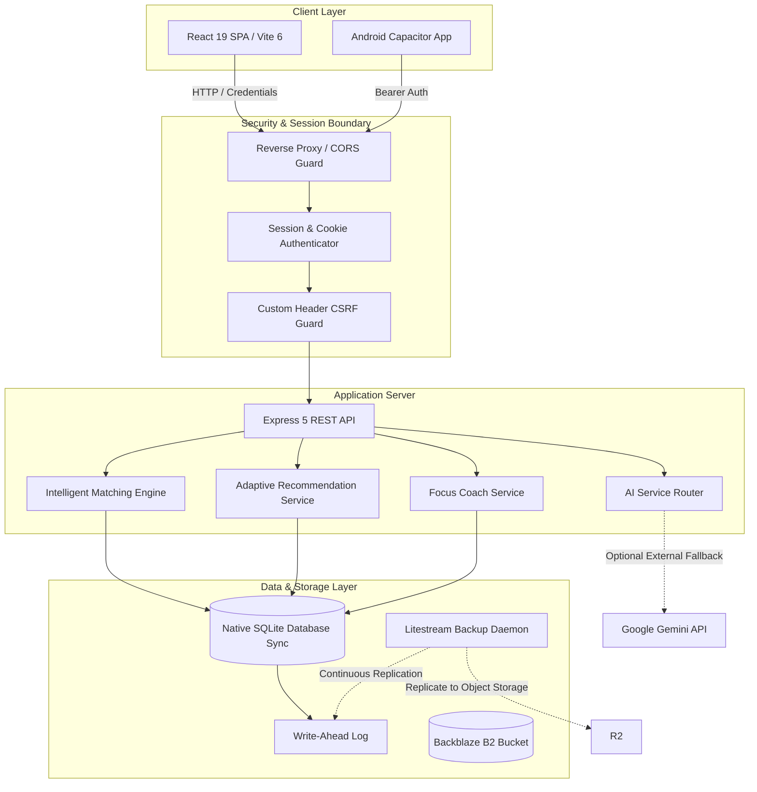

# StudySync AI — System Architecture

## 1. High-Level Architecture Diagram

---

## 2. Frontend Architecture

- **Core Framework**: React 19 (`react`, `react-dom` v19.0.0).
- **Tooling & Bundler**: Vite 6 (`vite` v6.2.0, `@vitejs/plugin-react` v4.3.4).
- **Routing**: React Router DOM v7 (`react-router-dom` v7.2.0) utilizing client-side SPA routing with authenticated route guards (`src/context/AppContext.jsx`).
- **Styling Architecture**: Pure Vanilla CSS Design Tokens (`src/styles/`). Zero third-party component libraries or utility engines (no Tailwind, no Material UI, no Bootstrap).
  - Modular CSS custom properties (`--color-primary`, `--surface-card`, `--spacing-md`, `--radius-lg`).
  - Dark mode and light mode theming via root attribute attributes (`[data-theme="dark"]`).
  - Fluid typography and continuous font scaling (12px to 24px) with high-contrast accessibility compliance.
- **State Management**: Centralized React Context (`src/context/AppContext.jsx`) managing authenticated user sessions, active room memberships, live discussion feeds, focus sprint timers, and notification suppression.
- **Mobile Container**: Capacitor 8 (`@capacitor/core`, `@capacitor/android` v8.5.3) packaging the compiled Vite SPA into an Android APK with secure HTTPS scheme binding (`androidScheme: "https"`).

---

## 3. Backend Architecture

- **Runtime**: Node.js v24 (ES Modules natively enabled via `"type": "module"`).
- **Framework**: Express 5 (`express` v5.3.0).
- **Layered Structure**:
  - `server/routes/`: Route controllers handling HTTP input parsing, parameter validation, and status code mapping.
  - `server/services/`: Pure business logic and domain services (`matching/`, `recommendation/`, `focus/`, `knowledgeMap/`, `email/`, `ai/`).
  - `server/models/`: Encapsulated database queries and schema access objects.
  - `server/db/`: Database connection singleton, idempotent migrations, seed fixtures, and backup utilities.
- **Zero Paid Dependencies**: Native Node.js built-ins (`node:sqlite`, `node:crypto`) are preferred over heavy external packages.

---

## 4. Database Architecture

- **Engine**: Native Node.js SQLite (`node:sqlite` via `DatabaseSync`).
- **Connection Configuration**:
  - Persistent disk file: `server/data/studysync.db` (configurable via `DATABASE_PATH`).
  - Journal Mode: `WAL` (Write-Ahead Logging) for safe concurrent reads during writes.
  - Foreign Keys: `PRAGMA foreign_keys = ON;` strictly enforced.
  - Concurrency Lock: `PRAGMA busy_timeout = 5000;` mitigating lock contention under load.
- **Versioned Idempotent Migrations** (`server/db/migrations/`):
  1. `001_initial_schema.sql`: Core users, user_profiles, study_sessions, quizzes, topic_assessments.
  2. `002_auth_and_profiles.sql`: Auth sessions, scrypt credentials, subjects, learning topics, learner profiles.
  3. `003_topic_rooms.sql`: Topic rooms, room memberships, room messages, questions/doubts, shared resources.
  4. `004_sessions_and_attendance.sql`: Discrete attendance intervals, session participation logs, post-session feedback.
  5. `005_notes_resources_and_doubts.sql`: User notes, access levels, question response threads.
  6. `006_safety_privacy_and_moderation.sql`: User blocks, abuse reports, moderation action logs.
  7. `007_recommendation_evaluation_and_learning_dna.sql`: Recommendation lifecycle tracking, explicit feedback, peer reviews, Learning DNA tags.

---

## 5. Authentication & Security Architecture

### 5.1 Password Hashing
- Utilizes Node.js native `crypto.scryptSync`.
- Derives a 64-byte key using a cryptographically secure random 16-byte salt per user.
- Stored as `salt:derivedKey` format.

### 5.2 Dual-Issuance Session Architecture
1. **Web & PWA Clients (Cookie-First)**:
   - On successful login/registration, the server issues a 64-character hex session token stored in an `HttpOnly`, `SameSite=Lax`, `Path=/` cookie (`studysync_session`).
   - Secure flag is dynamically enabled in production (`secure: process.env.NODE_ENV === 'production'`).
   - Web storage policy strictly prohibits saving raw tokens in `localStorage` or `sessionStorage` to mitigate XSS exfiltration.
2. **Native & Mobile Clients (Bearer Token)**:
   - The server simultaneously provides the token in the response JSON payload.
   - Mobile and API clients authenticate via `Authorization: Bearer <token>`.
3. **Session Revocation**:
   - Explicit `/api/auth/logout` deletes the session record from the SQLite `auth_sessions` table and clears the client cookie immediately.

### 5.3 CSRF & Request Hardening
- State-changing endpoints (`POST`, `PUT`, `DELETE`) authenticated via cookies enforce the presence of custom security headers (`X-Requested-With: XMLHttpRequest` or `Content-Type: application/json`).
- Prevents cross-origin HTML form execution.
- Configurable CORS origin: Strict exact-match checking in production (wildcard `*` rejected when credentials are enabled).

---

## 6. Deployment & Container Architecture

- **Single-Container Multi-Process Pattern**:
  - The production Docker image (`Dockerfile`) is based on `node:24-alpine`.
  - Serves both API routes (`/api/*`) and compiled static assets (`dist/`) from a single port (`3001` or container `PORT`), eliminating cross-origin CORS overhead in production.
- **Continuous Zero-Cost Persistence**:
  - Integrates `litestream` daemon alongside Node.js.
  - Replicates SQLite WAL frames in real time to any S3-compatible zero-cost storage (e.g., Backblaze B2's 10GB free tier, no credit card required).
  - On fresh container startup, Litestream automatically restores the latest database snapshot if the local disk volume is empty.
