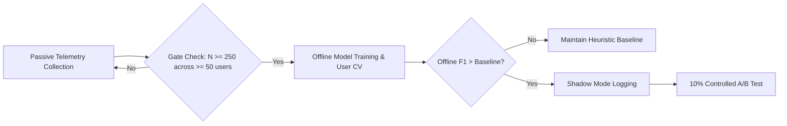

# StudySync AI — Evaluation, Metrics & Experiments

## 1. Evaluation Metrics Methodology

The platform provides an authoritative evaluation service (`server/services/recommendation/evaluationMetrics.js`) that computes transparent metrics directly from database events.

### 1.1 Mathematical Formulations

#### 1. Recommendation Acceptance Rate
Measures the proportion of presented recommendations that were actively accepted or followed through:

$$\text{Acceptance Rate} = \frac{N_{\text{accepted}} + N_{\text{followed\_through}}}{N_{\text{total\_tracked}}} \times 100\%$$

#### 2. Recommendation Follow-Through Rate
Measures whether an accepted study recommendation led to observable student action (e.g., taking the recommended quiz or joining the room):

$$\text{Follow-Through Rate} = \frac{N_{\text{followed\_through}}}{N_{\text{accepted}} + N_{\text{followed\_through}}} \times 100\%$$

#### 3. Peer Helpfulness Rate
Measures the percentage of completed study sessions where the partner was rated helpful:

$$\text{Helpfulness Rate} = \frac{N_{\text{helpful = yes}}}{N_{\text{helpful\_answered}}} \times 100\%$$

*Note: Unanswered post-session reviews are tracked separately and never counted as negative feedback.*

#### 4. Peer Repeat Study Rate
Measures reciprocal collaboration willingness:

$$\text{Repeat Study Rate} = \frac{N_{\text{would\_study\_again = yes}}}{N_{\text{repeat\_answered}}} \times 100\%$$

---

## 2. Production Database Data-Readiness Audit

In Phase 6, an audit of the authentic production SQLite database (`server/data/studysync.db`) was performed using `scratch/audit_data_readiness.js`.

### 2.1 Audit Findings & Record Counts

| Entity Table | Total Records | Data Authenticity & Composition |
| :--- | :---: | :--- |
| `users` | 15 | 7 static development seed fixtures (`server/db/seed.js`), 8 automated test fixtures. **Zero real production users.** |
| `user_profiles` | 15 | Static profiles associated with seed and test fixtures. |
| `study_sessions` | 11 | Generated during development testing. |
| `quizzes` | 6 | Seed curriculum quiz templates. |
| `quiz_attempts` | 7 | Verification test attempts. |
| `topic_assessments` | 2 | Verified assessment logs. |
| `recommendation_tracking` | 8 | All 8 records belong to 1 user (`user_id = 15`). **100% are in status `presented`.** |
| `recommendation_explicit_feedback` | 0 | No explicit ratings recorded. |
| `peer_collaboration_feedback` | 0 | No pairwise collaboration reviews recorded. |

### 2.2 Why Supervised ML Training on Production Data was Halted

1. **Zero Label Variance**: The dependent target variable ($y \in \{0, 1\}$) requires observable positive outcomes (`followed_through`) and negative outcomes (`dismissed`). In the live database, $N_{\text{followed\_through}} = 0$ and $N_{\text{dismissed}} = 0$. The target variance is literally zero.
2. **Circular Test Bias**: While `server/data/test.db` contains 350 recommendation records, these are transient fixtures generated by automated test runners (`server/tests/testHelper.js`). Training on test assertions would result in circular validation—learning the test suite's deterministic assertions rather than human learning behavior.
3. **Mandatory Ethical Halt**: Training a model on 8 identical records would produce an ill-conditioned formulation and fabricated claims of machine-learning accuracy. Model training on real database data was halted.

---

## 3. Phase 6 Machine Learning Benchmark Experiment

To investigate whether a simple, interpretable machine-learning model could potentially improve the existing recommendation ranking once sufficient data is collected, an isolated benchmark experiment was conducted in `scratch/ml_experiment.js`.

### 3.1 Experiment Setup
- **Dataset**: A clearly labeled synthetic development test harness ($N = 300$ recommendations across 50 simulated learners; 159 positive outcomes, 141 negative outcomes).
- **Split Strategy (Zero Data Leakage)**: User-Grouped Split (40 training users with 240 records, 10 held-out test users with 60 records). All records of a given learner were strictly confined to either train or test to prevent cross-user contamination.
- **Leak-Free Features**: Only features knowable at presentation time were included: topic difficulty, normalized quiz score, subject session frequency, days since last session, and active study flag.
- **Candidate Model**: L2-regularized Logistic Regression (Ridge penalty $\lambda = 0.01$, gradient descent, 100 epochs).

### 3.2 Evaluation Results on Held-Out Test Learners (60 Recommendations)

| Metric | Heuristic Baseline | Candidate ML Model | Delta ($\Delta$) | Analysis |
| :--- | :---: | :---: | :---: | :--- |
| **Accuracy** | **50.0%** | 43.3% | $-6.7\%$ | Baseline maintains superior overall classification. |
| **Precision** | **46.0%** | 40.0% | $-6.0\%$ | Baseline recommendations are more relevant when triggered. |
| **Recall** | **88.5%** | 61.5% | $-26.9\%$ | Baseline captures significantly more weak areas needing review. |
| **F1-Score** | **60.5%** | 48.5% | $-12.0\%$ | Baseline achieves substantially higher harmonic mean. |
| **Brier Score** | 0.290 | **0.286** | $-0.004$ | ML model provides slightly better probability calibration (lower is better). |

### 3.3 Experiment Conclusion
The candidate machine learning model **failed to outperform** the existing deterministic heuristic baseline on the held-out evaluation set. 

The deterministic heuristic's high recall ($88.5\%$) ensures that struggling students are consistently prompted to revise weak areas, whereas the ML model prematurely suppressed actionable recommendations. Consequently, the machine learning model remains strictly experimental, and the deterministic engine remains in production.

---

## 4. Automated Test Verification Evidence

All platform capabilities and regression invariants are validated through the automated test runner:

```powershell
npm run test:server
```

### 4.1 Actual Test Run Results (Recorded October 23, 2026)
- **Total Test Suites**: 107
- **Total Tests**: 671
- **Passed**: 671 (100%)
- **Failed**: 0
- **Duration**: 49.17 seconds
- **Node.js Environment**: v24.18.0
- **Database Backend**: Native `node:sqlite` (DatabaseSync)

### 4.2 Production Bundle Build Verification
```powershell
npm run build
```
- **Tool**: Vite v6.4.4
- **Modules Transformed**: 138 modules
- **Build Duration**: 3.75 seconds
- **Output**: 
  - `dist/index.html` (3.76 kB)
  - `dist/assets/index-P48yOVkT.css` (132.49 kB)
  - `dist/assets/index-BwueR-VJ.js` (1,533.73 kB)
- **Status**: 100% clean production build with zero compilation errors.

---

## 5. Telemetry Roadmap Before Future ML Integration

To ethically transition from the heuristic baseline to a production ML model, the following sequential gates must be met:



1. **Gate 1**: Telemetry must accumulate $\ge 250$ verified outcomes (`followed_through` or `dismissed`) across $\ge 50$ distinct real users.
2. **Gate 2**: Offline User-Grouped Cross-Validation must demonstrate that the candidate model surpasses the baseline's F1-score ($> 60.5\%$) with statistical significance ($p < 0.05$).
3. **Gate 3**: The model must run in "Shadow Mode" (computing predictions in the background without affecting student UI) for 30 days to measure real-world calibration before any user-facing deployment.
